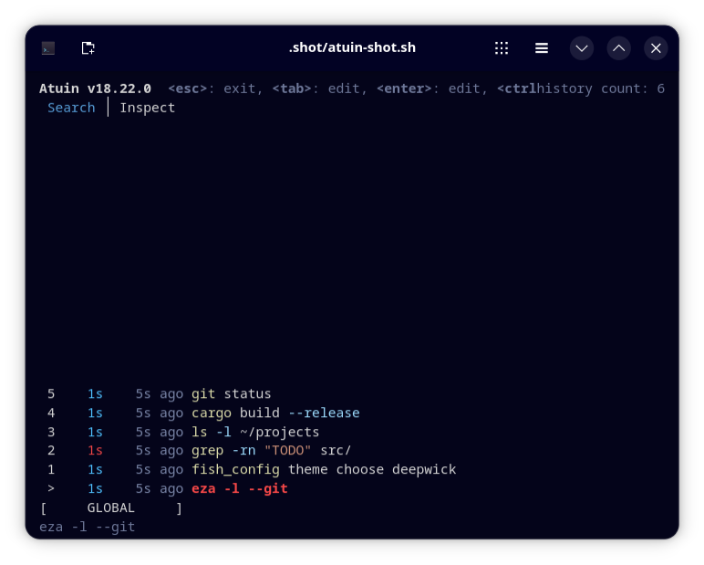

# Deepwick for Atuin

Deepwick colors for [Atuin](https://atuin.sh)'s interactive history search.

> Deepwick is an unofficial theme derived from
> [Polywick Blue](https://vscode.polywickstudio.net) by Polywick Studio (MIT).
> Not affiliated with Polywick Studio.



## Install

```sh
mkdir -p "${XDG_CONFIG_HOME:-$HOME/.config}/atuin/themes"
cp deepwick.toml "${XDG_CONFIG_HOME:-$HOME/.config}/atuin/themes/"
```

## Activate

In `${XDG_CONFIG_HOME:-$HOME/.config}/atuin/config.toml` (merge with an
existing `[theme]` section if you have one):

```toml
[theme]
name = "deepwick"
```

## Notes

- Atuin themes set text colors only: no bold, italic or backgrounds, so
  comments in the command preview are not italic.
- Successful commands' durations are Cyan (info), failures Red; relative
  times Comment; the active tab Blue. Atuin itself draws the selected command
  in the error color, bold.
- An unknown key makes Atuin ignore the whole theme; check with
  `[theme] debug = true`.

Tested with Atuin 18.22.0.

## License

MIT. See [LICENSE](LICENSE).
